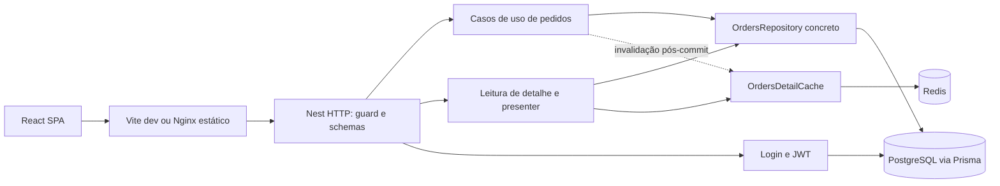

# naPorta: design técnico

**Status:** aprovado na revisão conjunta via Plannotator em 2026-10-21 (`decision: approved`) e executado: T1–T53 estão entregues (ver [tarefas](tasks.md)). Onde a implementação divergiu deste desenho, a divergência está em `docs/decisions.md`, seção "Desvios do plano".
**Spec:** [spec.md](spec.md), revisão 2 aprovada com adendo de branches.
**Limite da rodada de planejamento (histórico):** produzir os três artefatos e apresentá-los no Plannotator; a execução foi autorizada depois, no chat.
**Baseline do planejamento:** `feat/postgres-testcontainers` em `f039f21`, antes de qualquer execução.

## Architecture Overview

**Recomendação:** monólito Nest modular em `apps/api`, SPA independente em `apps/web`, pnpm workspaces e Turborepo na raiz. PostgreSQL continua sendo fonte de verdade. Redis acelera somente a montagem do detalhe, sem determinar existência ou revisão atual do pedido.

O usuário autorizou elaborar design e tarefas juntos. As alternativas abaixo são propostas para a revisão conjunta, não decisões técnicas adicionalmente aprovadas por silêncio.

| Alternativa para entregar o mesmo escopo | Benefício | Custo | Proposta |
| --- | --- | --- | --- |
| Dois apps, contratos HTTP documentados em OpenAPI, sem pacote compartilhado inicial | Mantém API independente; menor grafo de build; evita framework compartilhado | Tipos HTTP web precisam de verificação de contrato | Recomendada |
| Dois apps e pacote de schemas compartilhados | Reuso direto de validação e tipos | Acopla build web ao esquema de entrada da API; exige distinguir input/query de output | Não iniciar assim; extrair apenas se surgir duplicação que justifique o pacote |
| Dois apps e SDK web gerado do OpenAPI | Reduz drift de tipos | Adiciona geração/versionamento/infra de SDK a um cliente pequeno | Adiar, sem mudar o escopo funcional |



### Estrutura final proposta

```text
apps/
  api/
    src/
      main.ts
      app.module.ts
      app.controller.ts
      application.ts
      common/{errors,decorators,http}/
      config/
      prisma/
      generated/prisma/          # gerado, ignorado
      auth/
      orders/{dto,schemas}/
      cache/
      health/
      docs/
    prisma/{schema.prisma,migrations,seed.ts}
    test/{helpers,integration,e2e,contract}/
    scripts/export-openapi.ts
    Dockerfile
  web/
    src/
      app/                       # providers, router e layout
      lib/                       # cliente HTTP e formatação
      features/auth/
      features/orders/
      components/ui/             # componentes shadcn necessários
    test/e2e/
    Dockerfile
    nginx.conf
docs/{decisions.md,openapi.json}
scripts/                         # runners de provas locais, quando necessários
.specs/features/orders-api/       # planejamento seletivamente versionado no futuro
pnpm-workspace.yaml
pnpm-lock.yaml
turbo.json
biome.json
docker-compose.yml
```

Não criar package de UI, configuração publicada, repositório genérico, Redis de sessão ou cache de listas. Os nomes de arquivos que ainda não existem são destinos propostos, não arquivos encontrados no baseline.

## Code Reuse Analysis

| Componente atual | Origem | Reuso proposto |
| --- | --- | --- |
| Bootstrap, módulos e controller | `src/main.ts`, `src/app.module.ts`, `src/app.controller.ts` | Mover a API preservando ESM; separar factory testável de listen; manter resposta legada com proteção global. |
| Configuração Zod | `src/config/env.ts` e testes | Expandir schema sem imprimir `ZodError` com valores secretos; parse uma vez no startup e injetar configuração tipada. |
| PrismaService/Module | `src/prisma/` | Manter adapter PostgreSQL e provider único; resolver configuração ESM do client com geração/build/runtime reais. |
| Jest ESM | `jest.config.cjs`, configs em `test/` | Preservar runner e descoberta, ajustar rootDir/paths após mover; não trocar Jest por Vitest na API. |
| Testcontainers | `test/integration/setup.ts` | Extrair lifecycle reutilizável, adicionar migrations, reset de dados e posteriormente Redis; manter isolamento de DATABASE_URL. |
| Compose PostgreSQL 17 | `docker-compose.yml` | Preservar nome do volume e major/layout; tornar porta configurável e acrescentar serviços sem remover dados. |
| Scripts/lockfile | `package.json`, `pnpm-lock.yaml` | Usar pnpm 10.33.0; scripts da raiz delegam para os apps; aliases legados documentados. |

### Amostra de testes e política de compatibilidade

Foram lidos seis arquivos: controller unitário, env, lifecycle Prisma, fixture ValidationPipe, HTTP do controller e integração Prisma. As configs são a fonte dos comandos atuais; a spec/handoff é a fonte da profundidade exigida. A contagem estática sugere 13 casos unitários parametrizados, um HTTP isolado e um de integração; isso não é resultado de execução nem cobertura medida.

`src/common/validation.pipe.spec.ts` testa uma fixture construída no próprio teste com class-validator. Preservar suas asserções como regressão do bootstrap; a fixture não justifica manter duas validações no runtime novo. Manter dependências legadas em dev quando necessárias a essa fixture. O teste HTTP isolado também não é prova de segurança do AppModule: acrescentar prova real de guard, sem eliminar o teste de resposta do controller. Mudança do contrato público de GET / para protegido já está na spec aprovada.

## Components

As assinaturas abaixo são contratos internos propostos do projeto, não APIs alegadamente fornecidas pelas bibliotecas.

| Componente e localização final | Responsabilidade/interface | Dependências e reuso |
| --- | --- | --- |
| Config em `apps/api/src/config/` | `loadApiConfig(env)`, `loadSeedConfig(env)`; erros com nomes de campos, sem valores; configuração imutável injetada | Zod e env atual; seed exige suas credenciais, API não exige senha de seed |
| Application factory em `apps/api/src/application.ts` | `createApplication(config)` configura HTTP/docs sem listen; main escuta e habilita shutdown; export de docs usa modo sem init/conexão | Nest e bootstrap atual |
| Request ID middleware | UUID gerado por requisição, header X-Request-Id, contexto interno sem payload | Node crypto; não aceitar ID arbitrário como substituto |
| ProblemDetailsFilter | Traduz erro conhecido e HttpException preservando status; JSON inválido vira VALIDATION_ERROR; inesperado vira 500 seguro | Mapper Prisma específico e logger Nest estruturado, sem log de exceção bruta |
| AuthService/Controller | `login(credentials)` consulta User por email normalizado, verifica argon2id, assina HS256; POST 200 | Prisma, @nestjs/jwt e biblioteca de hash compatível; fallback bcrypt só com evidência de incompatibilidade |
| Public decorator e JwtAuthGuard | Metadata em classe/método via Reflector; guard global APP_GUARD valida assinatura/exp/iss/aud e anexa principal mínimo | Nest/JWT; sem @CurrentUser enquanto não tiver consumidor real |
| HealthController | GET público consulta banco; 200 exato ou ProblemDetails 503 | Prisma; não depende de Redis estar online |
| Schemas de pedidos | Um módulo de schemas de entrada com objetos estritos, tipos inferidos, trim e datas reais; query numérica explícita | Zod e Standard Schema nativo disponível nos tipos instalados |
| OrdersRepository | `create`, `findActiveDetail`, `findActiveRevision`, `list`, `patchActive`, `softDeleteActive`; projeções concretas tipadas | PrismaService; nada de interface CRUD genérica |
| OrdersService | Casos de uso e erros de domínio; não consulta Request nem instancia DTO HTTP | Repository concreto; métodos de write concluem transação antes de notificar cache |
| OrderPresenter | `detail(model)`, `summary(model)`; datas civis/UTC, JSONB público e soma em number seguro | Projeções tipadas; não acessa banco/cache |
| OrdersDetailReader | GET detail: consulta revisão ativa, tenta cache válido, ou usa service/presenter e preenche cache; retorna DTO | Repository/service, presenter e OrdersDetailCache |
| RedisService | Cliente compartilhado, estado ready, deadlines e lifecycle; não bloquear startup se indisponível | node-redis compatível; sem offline queue na requisição |
| OrdersDetailCache | `get(id)`, `put(id, entry)`, `invalidate(id)`; codec estrito e contadores hit/miss/error; TTL/namespace | RedisService; nenhum cache global no Nest |
| Web HTTP client | `request<T>(path, options)` trata Bearer/ProblemDetails/204/401/rede; sem retry automático de writes | fetch; tipos HTTP locais confrontados com OpenAPI |
| SessionProvider | Estado em memória: anonymous/authenticated; setSession/logout; callback de 401 limpa dados e razão de expiração | React Context; não Redux, cookies ou browser storage |
| Router e layout | React Router em modo declarativo, rotas protegidas, logout e fallback; sem modo framework ou SSR | BrowserRouter/Routes/Outlet, shadcn/ui mínimo |
| Pages de pedidos | Cada página usa cliente HTTP, estado assíncrono e componentes de formulário; recarrega dados após sucesso | React state/effects com cancelamento/ordenação de requests |
| Order form model | Normaliza formulário e produz Create ou PATCH de alterações, sem campos privados; não replica regras de negócio | Tipos HTTP e regras de edição de objetos/coleções da spec |

### Validação e documentação

Os tipos instalados de `@nestjs/common` expõem StandardSchemaValidationPipe e a opção schema nos decorators. Usar esse caminho com exceptionFactory para erro 400 por campo. Teste de contrato verificará se a versão escolhida de @nestjs/swagger transforma corretamente os schemas em corpos/parâmetros, inclusive query antes de coerção, `additionalProperties: false`, PATCH não vazio e refine de período.

Se a integração Swagger não representar uma regra Zod, complementar sua descrição/examples por metadata sem duplicar limites manualmente. Caso nativo não funcione no smoke, usar um pipe Zod fino e uma conversão explícita do mesmo schema para OpenAPI; registrar a causa antes de mudar o caminho. Não aceitar geração vazia como sucesso.

DTOs de saída são distintos da entrada e registrados explicitamente no Swagger; controller usa presenter. Cada endpoint leva suas respostas/exemplos/testes de contrato no próprio commit. O export `docs:openapi` monta o grafo Nest sem `app.init()`/listen e sem conectar Prisma/Redis, usando env sintético não secreto de documentação. Ordenar chaves/operationIds e eliminar dados variáveis. Fechar recursos mesmo na falha. `docs/openapi.json` será versionado e uma comparação de regeneração detectará drift.

## Data Models

| Modelo | Tipos/constraints propostos |
| --- | --- |
| User | UUID PK; email Text unique lowercase; passwordHash Text; createdAt/updatedAt Timestamptz(3) |
| Order | UUID PK; orderNumber Text unique; status enum default PENDING; expectedDeliveryDate DATE; customerName/customerDocument Text; deliveryAddress JsonB; createdAt/updatedAt Timestamptz(3); deletedAt Timestamptz(3) nullable; cacheRevision Int default 1 |
| OrderItem | UUID PK; orderId UUID FK; description Text; priceCents INTEGER; índice orderId |

Migrations explicitam nomes das constraints relevantes, em especial orderNumber, para mapeamento específico. Relação Order 1:N OrderItem. Exclusão da API nunca remove registro/itens. Sem tabela de cliente/endereço e sem total persistido. UUIDs com default compatível com a versão Prisma escolhida; documento e hashes nunca em logs.

Índices iniciais: unique orderNumber, orderId e composto `(deletedAt, createdAt, id)` justificado pelo filtro de ativos e ordenação da listagem. Índice por status só será adicionado se EXPLAIN das queries reais justificar; não é pré-requisito de aceite.

### Escritas e concorrência

- POST: nested create de pedido/itens; erro P2002 somente na constraint de orderNumber vira conflito de pedido. A unique no banco arbitra concorrência, não um find anterior.
- PATCH: transação interativa curta com ReadCommitted explícito. Primeiro `updateMany` condicional em id + deletedAt null atualiza campos escalares/JSONB e incrementa cacheRevision. Se count 0, lançar ORDER_NOT_FOUND antes de tocar itens. Essa escrita trava a linha de Order até commit. Depois, somente se items estiver presente, deleteMany dos itens daquele orderId e createMany dos novos; ler projeção de detalhe antes de concluir. Sem acesso Redis dentro da transação.
- DELETE: updateMany condicional sobre o pedido ativo, com deletedAt e incremento de revisão; count 0 vira 404. A mesma linha pai serializa DELETE contra PATCH.
- ReadCommitted no PostgreSQL reavalia o WHERE de UPDATE após aguardar transação concorrente. Assim, DELETE que vence faz PATCH posterior obter count 0; PATCH que vence conclui antes de DELETE. Nunca ler ativo e depois atualizar só por id sem condição.
- PATCHes concorrentes adquirem a linha pai antes de mexer na coleção: não intercalar delete/create dos itens. Não adicionar ETag, versão pública ou retry genérico de POST. Todas as mutations passam por esse protocolo; nenhum segundo caminho de escrita ignora revisão.
- Falha em qualquer write de itens reverte escalares, itens e revisão. Invalidação Redis só ocorre após resolução da transação. Erros não conhecidos preservam categoria de falha interna, não são convertidos indiscriminadamente em 409.

### Leituras

- Lista: `where` único reutilizado em findMany/count, deletedAt null, igualdade exata e AND, select de resumo, skip/take e sort createdAt DESC/id DESC. Count e página independentes, sem promessa de snapshot conjunto sob escrita concorrente.
- Datas de query: validar calendário primeiro; construir limites UTC de início de dia e início do próximo dia. Nunca usar horário 23:59:59.999 como limite superior.
- Detalhe sem cache: buscar ativo com select e nested select de itens. Para que itens e revisão usados no preenchimento do cache representem o mesmo snapshot quando Prisma fizer mais de um SELECT, executar a leitura completa em transação somente-leitura RepeatableRead. Nenhuma rede Redis dentro dela.
- Presenter não depende do fuso do host: extrai a data civil sem conversão local; timestamps saem ISO UTC; soma em JS number, até 100000000000 conforme spec.

### Seed

Seed é comando explícito, nunca startup da API. Normalizar email, hashear senha e upsert do usuário. Para os 12 números reservados, criar somente ausentes com nested items; não alterar ou ressuscitar existentes. Fixtures determinísticas representam os cinco status e três dias UTC ou mais. Não executar SQL customizado no entrypoint PostgreSQL. A base de criação de fixtures é reutilizada somente em testes/seed, sem importar persistência no cliente web.

## Cache-aside e falhas de dependência

Envelope Redis: `{ revision: number, data: OrderResponse }`, chave `naporta:v1:orders:{id}:detail`. O codec valida shape completo e igualdade do id solicitado; campos privados são rejeitados no payload. TTL padrão 60 s. revision não é devolvida ao consumidor.

Algoritmo do reader:

1. Consultar ativo/revisão em PostgreSQL, projeção pequena. Ausente implica 404, sem consultar/servir entrada antiga.
2. Redis ready: GET com deadline; payload válido e revision igual permite hit sem recarregar itens. Nenhuma verificação de metadata permite bypass de JWT.
3. Miss, payload inválido, versão incompatível ou Redis não disponível: buscar snapshot completo ativo, com revisão, no banco; gerar DTO e tentar SET com TTL.
4. PUT/GET/DEL que falha registra contador seguro e não substitui resposta de negócio. Deadline e offline queue desativada impedem que a requisição espere reconexão. Cliente tem error handler e teardown; falha de conexão no startup é capturada sem logar URL/credenciais.
5. Após PATCH/DELETE commitado, tentar DEL antes de concluir seu fluxo HTTP, respeitando o deadline. Falha de DEL não desfaz commit nem produz erro falso de write. Leitura seguinte usa revisão persistida e descarta cache antigo.

Uma leitura antiga pode repopular a chave após DEL. Ela não poderá satisfazer nova consulta cuja revisão atual difira. Uma escrita antiga de cache pode reduzir hit rate ao substituir entrada nova, mas não mudar dados públicos. Não é necessário lock distribuído, outbox, Lua ou stampede protection para cumprir esta spec. Nenhum ganho de latência é alegado sem medição; há intencionalmente uma consulta pequena ao banco em cada hit.

`CACHE_TIMEOUT_MS` limita cada operação de cache a 200 ms por padrão; timeout do socket e timeout de comando são coisas diferentes. A implementação verificará a API de cancelamento da versão instalada. `Promise.race` sozinho não é considerado limpeza/cancelamento suficiente: o comando não pode ficar numa fila offline para execução tardia sem controle. Erro inesperado do PostgreSQL segue 500; saúde do banco 503; Redis nunca permite servir snapshot sem checar atividade.

## Frontend

React/Vite + TypeScript, React Router declarativo, shadcn/ui e Tailwind necessário. State/effects e fetch são suficientes; sem Redux/TanStack Query/form framework adicional neste desenho. Separar HTTP de visualização e considerar cancelamento/ordem de respostas ao trocar filtros ou id para não renderizar uma resposta anterior sobre a atual.

| Rota | Responsabilidade e estados |
| --- | --- |
| /login | Email/senha, pending, erro de credenciais/rede; sucesso cria sessão em memória e vai à lista |
| /orders | Filtros explícitos, limpar, tabela, meta/prev/next, loading/erro/vazio; mudar filtro reseta page 1 |
| /orders/new | Formulário de criação; 201 leva ao detalhe; 400 por campo/409 no número; sem retry automático de POST |
| /orders/:id | Campos, itens/total/data, loading/erro/404; ações de editar e excluir |
| /orders/:id/edit | Carrega detalhe; form model compara initial/current; PATCH só alterações; completo para objeto/coleção alterado |

OrderForm compõe CustomerFields, AddressFields e ItemsEditor. Preço é input de centavos inteiros, sem parseFloat/arredondamento de reais. Cada grupo tem labels e mensagem de campo. Cancelar exclusão não dispara chamada; confirmar bloqueia duplo clique; 204 atualiza lista. Não tratar 404/401 como erro recuperável por retry cego. Não fazer mutation otimista.

SessionProvider guarda token e razão de encerramento apenas em memória. HTTP client recebe o token em cada chamada; 401 protegido encerra sessão, 401 do login informa credenciais. Logout/401 descartam dados privados da UI e abortam requisições pendentes. Reload do host web serve a SPA e volta ao login por ausência de sessão. Nem token nem configuração privada entram em URL/browser storage/bundle.

Vitest/Testing Library cobre componentes e serialização com transporte controlado. Playwright usa Chromium real, context por teste e viewports 390/1280. Harness já nasce na etapa de plataforma web para cada página levar seu cenário real no mesmo commit; não é um pacote de testes adiado ao fim.

## Monorepo, scripts e containers

- Packages propostos: `@naporta/api` e `@naporta/web`. pnpm-workspace inclui apps/*; não criar web placeholder só para satisfazer o glob. API é migrada antes de adicionar web. Um lockfile na raiz.
- Turbo orquestra build/typecheck/test:unit/dev; dev persistente com cache false. Build pode usar cache de dist com env público/inputs declarados; geração Prisma deve funcionar em checkout limpo e não depender de artefato ignorado da máquina.
- Migrations, seed, integração, browser E2E, smoke Docker e provas finais têm cache false. Evitar cache hit de cobertura/testes na prova final, mesmo se houver cache local de build; não usar cache remoto.
- Coverage API/web é separado, >=80% lines e >=70% branches em cada conjunto de lógica própria para que um app não esconda o outro. Incluir todos os arquivos elegíveis, inclusive não importados. Excluir somente bootstrap/gerados/vendor com justificativa; UI própria e cache entram.
- `.gitignore` terá exceções só para `.specs/STATE.md` e `.specs/features/orders-api/**` quando T1 for autorizada. Planos históricos continuam ignorados. A migração atualizará os ignores de gerados/build para os dois apps; nunca versionar .env.

### Runtimes e imagens

API Dockerfile tem targets dependencies/build/runtime e um target migrate com Prisma CLI e migrations. Runtime API contém client gerado, dist e dependências de produção, roda usuário não-root e não executa migrate dev/seed. O target migrate é comando explícito one-shot, não precisa carregar código web. Node base deve satisfazer a interseção dos engines já declarados e das novas dependências estáveis, sem inventar versão nesta etapa; T2/T31 verificam e registram a escolha compatível. PostgreSQL permanece 17 Alpine.

Web Dockerfile compila Vite e serve dist por Nginx não-root. `/api/` faz proxy sem fallback SPA e preserva status/headers como Location e X-Request-Id; arquivos inexistentes não viram resposta de API HTML. Rotas visuais têm fallback index.html. Servir `/docs` pelo host API documentado, sem exigir proxy especial no web.

Compose mantém postgres e volume atual; acrescenta redis sem persistência/porta pública, migrate one-shot, api e web. API depende de postgres healthy e migrate completed_successfully; Redis pode estar started sem bloquear sua disponibilidade por health. Web depende da saúde da API; todos os serviços long-running têm healthchecks adequados. Portas host configuráveis e loopback. Valores reais em env não versionado; placeholders não dão startup silencioso.

Roteiro final documentará: preparar env, iniciar banco/Redis, executar migrate deploy, seed explícito e subir API/web. Dependências Compose impedem receber tráfego antes de migrations. Nada disso será executado nesta rodada. Smoke usa nome de projeto, volumes e portas exclusivos, preservando `postgres_data` de desenvolvimento. Não fazer down -v sobre projeto preexistente.

## Error Handling Strategy

| Cenário | Tratamento | Efeito ao consumidor |
| --- | --- | --- |
| Entrada inválida | Standard Schema/schema estrito + filtro global; não devolver valores de issues | 400 VALIDATION_ERROR e fields seguros |
| Bearer inválido | Guard com validação explícita de algoritmo/issuer/audience/exp | 401 UNAUTHORIZED |
| Credenciais inválidas | Mesmo erro para email ausente e senha errada; hash seguro | 401 INVALID_CREDENTIALS |
| Unique orderNumber | Mapper da constraint específica, testado também no PATCH | 409 ORDER_NUMBER_ALREADY_EXISTS |
| Count 0 em write ativo ou leitura ausente | Erro de domínio mapeado pelo filtro | 404 ORDER_NOT_FOUND |
| Falha de item na transação | Propagar e rollback; não invalidar cache como write concluído | Erro seguro, dados anteriores intactos |
| Redis indisponível/payload inválido | Miss/fallback; deadline e contador | Mesmo dado/erro que o banco autoriza |
| PostgreSQL fora no health | Capturar erro conhecido de disponibilidade sem detalhes do driver | 503 SERVICE_UNAVAILABLE |
| HTTP nativo adicional | Preservar status e usar HTTP_ERROR seguro | Não converter tudo em 400/500 |
| Falha inesperada | Log estruturado allowlist requestId/method/route, sem erro cru | 500 INTERNAL_SERVER_ERROR genérico |

## Risks & Concerns

| Concern | Location (file:line) | Impact | Mitigation |
| --- | --- | --- | --- |
| ESM app com Prisma gerado CJS | `package.json:6`, `prisma/schema.prisma:4` | Resolver/compilar pode funcionar no Jest e falhar em Node compilado | T2/T8 geração+build+runtime; preferir generator ESM compatível sem migrar major por conveniência. |
| Jest 30 e ts-jest 29 declarados | `package.json:50`, `package.json:53` | Compatibilidade não foi medida; não assumir que a suite atual passa | T2 registra engines/peers e baseline; incompatibilidade requer ajuste mínimo provado, não troca arbitrária do runner. |
| Env obrigatório lido no construtor | `src/prisma/prisma.service.ts:13`, `src/config/env.ts:14` | Tests/docs podem exigir segredos e imprimir valores de ZodError | T5 config tipada injetada; factory de docs sem init; testes com env seguro. |
| Exceção bruta no startup | `src/main.ts:22` | Credenciais/URL podem chegar ao terminal | T5/T6 sanitizam startup e logger, além do filtro HTTP. |
| Testes HTTP são fixtures isoladas | `test/e2e/app.e2e-spec.ts:11`, `src/common/validation.pipe.spec.ts:27` | Podem passar sem configurar o guard/pipe real | Preservar fixture e acrescentar AppModule real; T17 e endpoint tasks incluem integrações. |
| Harness atual sem migrations/reset | `test/integration/setup.ts:20` | Novos modelos dependem de tabela inexistente; testes passam por ordem | T9 migra e isola; Redis se incorpora em T26; cleanup em falha parcial. |
| Ignore amplo de planejamento | `.gitignore:6` | Commits atômicos não conteriam tasks/traceability | T1 exceções seletivas e teste documental de arquivo rastreável; não mudar hoje. |
| Biome ainda não fixa estilo pedido | `biome.json:1` | Grande reformat pode esconder mudança funcional | T4 formatação isolada, migração de paths em T2, sem unsafe autofix global. |
| Dois SELECTs de detalhe podem ver snapshots distintos | Spec ORDER-12/CACHE-05 | Cache pode associar revisão antiga a itens novos | Snapshot RepeatableRead na leitura completa; teste I29 com barreiras reais. |
| DEL+TTL insuficiente em corrida | Spec CACHE-03/05 | Cache poderia reaparecer após delete ou servir dado anterior | Revisão atômica + confirmação ativa no banco em cada hit; I28/I29. |
| Env VITE_ é público | Spec WEB-01..03 | Segredo poderia ser compilado no cliente | Allowlist só base URL pública; inspeção do bundle nos gates web/container. |
| UI recebe respostas fora de ordem | Spec WEB-04/09 | Filtro ou pedido antigo sobrescreve estado atual | Cancelamento/identidade da requisição, testes de componente e browser. |

## Tech Decisions

| Decisão proposta | Escolha | Trade-off |
| --- | --- | --- |
| Branches | Conformar AD-001, uma por etapa encadeada; mapa em branches.md | Diffs devem usar a branch-base anterior, não main. |
| Contratos entre apps | OpenAPI + tipos HTTP web locais testados, sem pacote compartilhado inicial | Menos tooling, mas requer teste explícito de compatibilidade de payloads. |
| Escrita concorrente | Update condicional da linha pai antes de itens, transação curta ReadCommitted | Evita SQL bruto/locks Redis; depende de todos os writers seguirem o protocolo. |
| Cache consistente | Revisão interna persistida e validação ativa no banco | Hit não é zero-SQL; preserva semântica forte de soft delete. |
| Snapshot do detalhe | RepeatableRead somente durante leitura completa | Pequena transação adicional; evita associar revisão e itens de instantes distintos. |
| Auth web | Memória, sem refresh token | Reload exige login; evita persistência do Bearer. |
| Roteamento web | React Router declarativo, não framework mode | Mantém SPA simples e sem SSR. |
| Instrumentação de prova | Barreira/injeção restrita a helpers de teste, nunca endpoint debug de produção | Provas de rollback/corrida reproduzíveis sem sleeps ou enfraquecer runtime. |

Nenhuma decisão arquitetural nova deste rascunho foi promovida a AD ativo no estado global. A decisão de branches já é ativa por instrução explícita do usuário.

## Evidência técnica e pontos de verificação

- Tipos locais: `node_modules/@nestjs/common/pipes/standard-schema-validation.pipe.d.ts` e `decorators/http/route-params.decorator.d.ts` confirmam existência dos recursos; não comprovam integração Swagger ou runtime.
- Context7: `/nestjs/docs.nestjs.com` para schemas/exceptionFactory; `/vercel/turborepo` para tasks/persistent/cache; `/vitest-dev/vitest` para jsdom e thresholds; `/microsoft/playwright` para fixtures/viewports; `/remix-run/react-router` para modo declarativo.
- A consulta geral `/prisma/web` retornou também API mais nova (`db.orm`, updateAll). Não usá-la com Prisma 7. A documentação oficial versionada [Prisma 7 transactions](https://www.prisma.io/docs/orm/v7/prisma-client/queries/transactions) confirma `$transaction`, updateMany, increment e isolamento.
- [PostgreSQL 17 Read Committed](https://www.postgresql.org/docs/17/transaction-iso.html#XACT-READ-COMMITTED) documenta a espera/reavaliação de WHERE em UPDATE concorrente. A interpretação será demonstrada por I15, não apenas por mock.
- Redis, Vite, shadcn/ui e Docker: documentação Context7 já consultada na spec. Versões novas serão resolvidas e pinadas somente na tarefa autorizada; não há instalação ou certificação de versão feita aqui.

## Revisão e parada obrigatória

Revisar em conjunto este design, tasks.md e branches.md. Nenhuma task está concluída. Nenhuma branch proposta existe por causa deste planejamento. Validadores estruturais verificam os documentos, não aprovam runtime. Ao terminar a revisão, parar e aguardar autorização explícita para execução.
